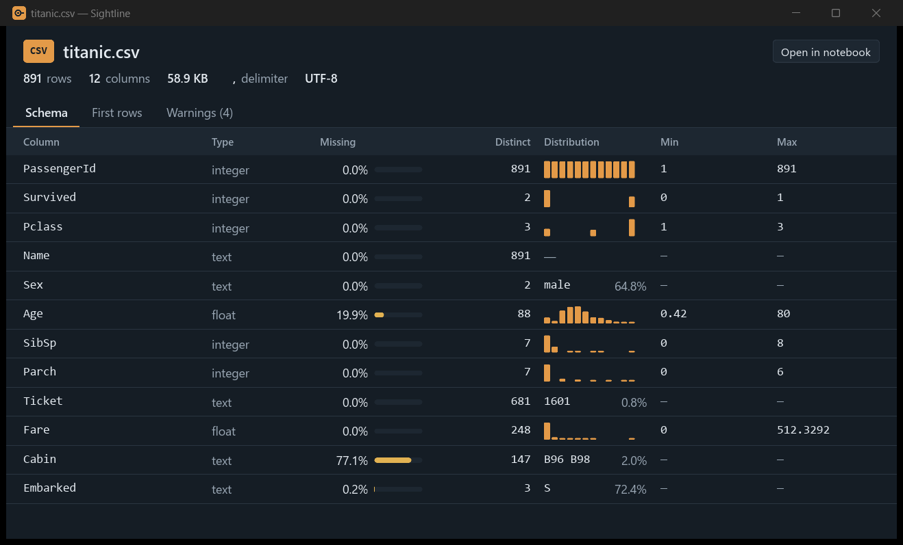
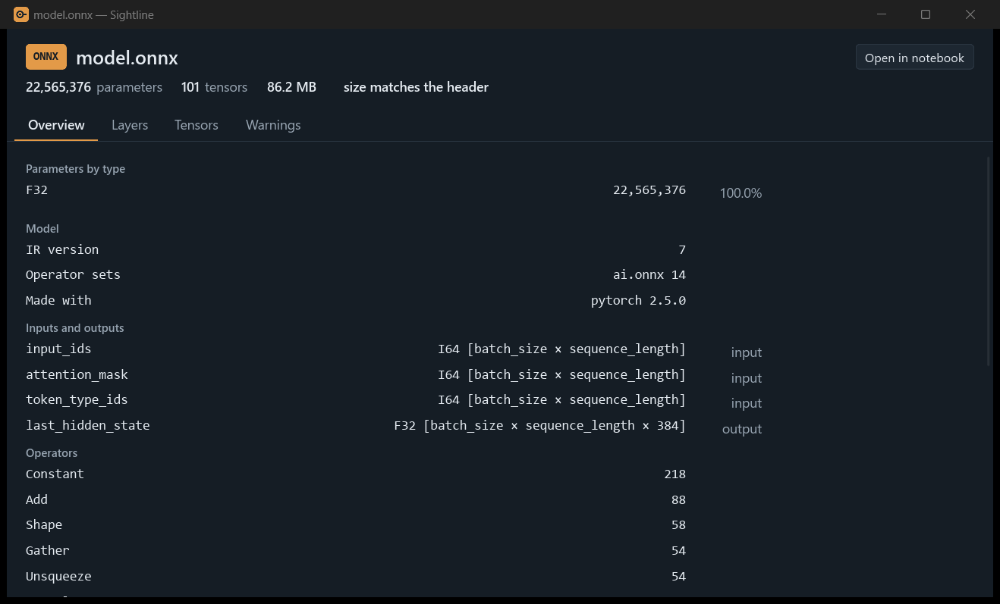
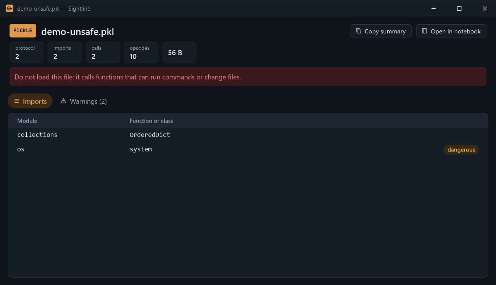
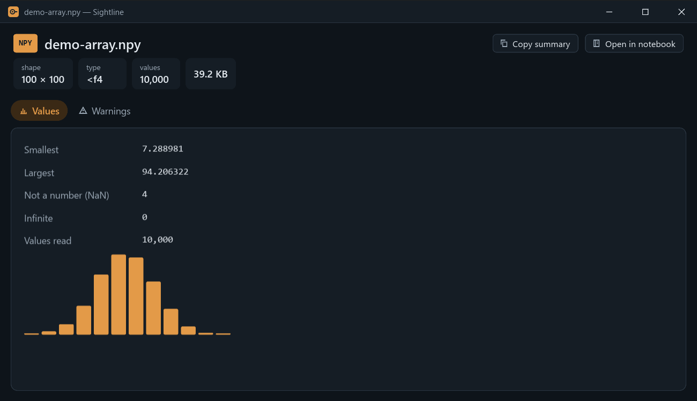

# Sightline

See inside your data files without opening them.

Sightline is a small Windows app for data scientists and ML engineers. Select a CSV, Parquet, Excel, NPY, safetensors, ONNX or pickle file in Explorer, press Space, and a window shows what is inside: the schema, row count, missing values and distributions of a table; the layers, tensor shapes and parameter count of a model; the shape and value range of an array; the functions a pickle would call if you loaded it. No Python, no notebook, no waiting for a 1 GB file to load.

[Türkçe](README.tr.md)



## What it reads

| File | What you see |
|---|---|
| CSV | Delimiter and encoding (UTF-8 or Windows-1254), column types, missing values, distinct counts, histograms or most frequent values, min and max, first rows, warnings |
| Parquet | The same, with the row count and statistics taken from the file footer; samples spread over the whole file |
| Excel (`.xlsx`, `.xlsm`) | The same for the first sheet, with the names of all sheets; dates shown as dates, formula results as Excel saved them (formulas are never calculated, macros never read) |
| safetensors | Every tensor with its type and shape, total parameters by type, a layer tree, metadata, and a check that the file is as long as its header says |
| ONNX | IR and operator set versions, producer, inputs and outputs with their shapes, operator counts, initializers and parameters |
| NPY | Shape, type, memory order, min, max, NaN and infinite counts, a histogram (sampled for large arrays) |
| Pickle (`.pkl`, `.pickle`) | Protocol, the functions and classes it imports, how many calls it makes, and a warning for dangerous ones such as `os.system` |

Warnings point at things worth checking before training: columns with many missing values, ID-like columns, columns with a single value, strongly skewed numbers, date ranges.

"Open in notebook" writes a Jupyter notebook with code that reads the file, into `Documents\Sightline`, and opens it.



## Safe by design

- **Files are never changed.** Sightline only opens files for reading.
- **Nothing leaves your computer.** There is no network code.
- **Pickles are never loaded.** Loading a pickle can run any code. Sightline walks its opcodes without building a single object, and lists what it would import and call. Arrays of Python objects in `.npy` files are not read for the same reason, and the generated notebook for a pickle only lists its opcodes with `pickletools`.
- **Large files stay cheap.** Readers look at headers and samples, never at whole weight files. ONNX weights are skipped without being read, and weights kept in external files are not opened.



## Measured

| What | Result |
|---|---|
| Summary of a 1.08 GB Parquet file (32 million rows) | 102 ms median, 91 MB peak memory |
| Summary of a 1.2 GB safetensors file | 9.6 ms median, 5.3 MB peak memory |
| Summary of a 1.2 GB NPY file | 39.3 ms median, 21.2 MB peak memory |
| Space in Explorer to the preview window in front | 11.1 ms median |
| Parameters of `sentence-transformers/all-MiniLM-L6-v2` (safetensors) | 22,713,728, the same as Hugging Face reports |

Timings are medians of 10 runs of the release build on files already in the disk cache.

## Install

1. Download `Sightline-1.0.0-windows-x64.zip` from the [Releases](https://github.com/AlicanKaya192/Sightline/releases) page and unzip it.
2. Run `sightline-app.exe --install` from the unzipped folder.

This copies Sightline to `%LOCALAPPDATA%\Programs\Sightline` and adds a Start menu shortcut, the "Preview with Sightline" entry to the Explorer context menu, and an entry in Settings > Apps. It needs no administrator rights and Python is not required. The program is not code-signed, so Windows may warn before the first start.

To remove it, uninstall Sightline from Settings > Apps, or run `sightline-app.exe --uninstall`. Your data files are never touched.

You can also run `sightline-app.exe` from any folder without installing it.

## Use

- **Drag and drop** a file onto the window, or **right-click** it in Explorer and choose "Preview with Sightline".
- **Space in Explorer:** start Sightline with `sightline-app.exe --tray`. It waits in the notification area; select a supported file in Explorer and press Space. The tray menu can start it with Windows (off by default).
- **Copy summary** puts the summary on the clipboard as plain text, in the window's language. **Esc** closes the window.
- **Language:** the window follows the Windows language (English or Turkish). The About screen lets you pick one, and Sightline remembers it; `--lang en` or `--lang tr` overrides it for one start.
- **Command line:** `sightline.exe ozet <file>` prints the same summary as text.



## Build from source

Sightline is written in Rust with the [Slint](https://slint.dev) UI toolkit. With Rust (MSVC toolchain) installed:

```
cargo build --release
cargo test --workspace
```

| Crate | Role |
|---|---|
| `crates/sightline-core` | File readers and summaries, independent of any user interface |
| `crates/sightline-app` | The window, Explorer integration, tray, installer |
| `crates/sightline-cli` | `sightline ozet <file>` |

## Limits

- PyTorch `.pt` and `.pth` files, `.npz`, sharded safetensors, GGUF, old `.xls` workbooks and `.ods` files are not supported yet.
- Only the first sheet of an Excel workbook is summarized; a sheet is read up to 64 MB of unpacked XML, and longer sheets give "at least" row counts.
- ONNX parameter counts include initializers only. A model exported to ONNX can differ from its safetensors version: in all-MiniLM-L6-v2 the export leaves out the unused pooler layer and the `position_ids` buffer (148,352 values).
- The Explorer preview pane (Alt+P) and comparing the schemas of two files are planned for a later version.
- The `.exe` file itself shows the default Windows icon in Explorer; the window, tray, Start menu and Settings use Sightline's icon.

## License

Sightline's own source code is under the MIT License, see [LICENSE](LICENSE). The window uses the Slint UI toolkit under the GNU General Public License v3, so `sightline-app.exe` as distributed is under the GPL v3, see [LICENSE-GPL-3.0.txt](LICENSE-GPL-3.0.txt). The command-line tool `sightline.exe` does not use Slint and is under the MIT License only.
