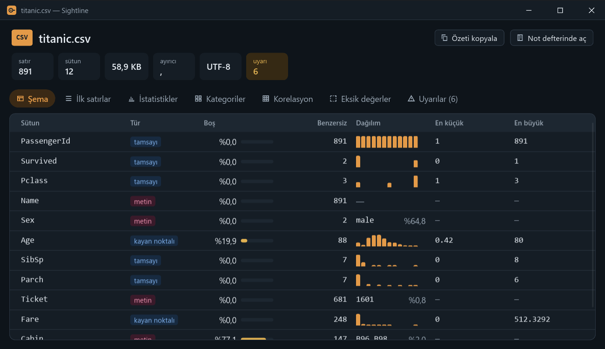
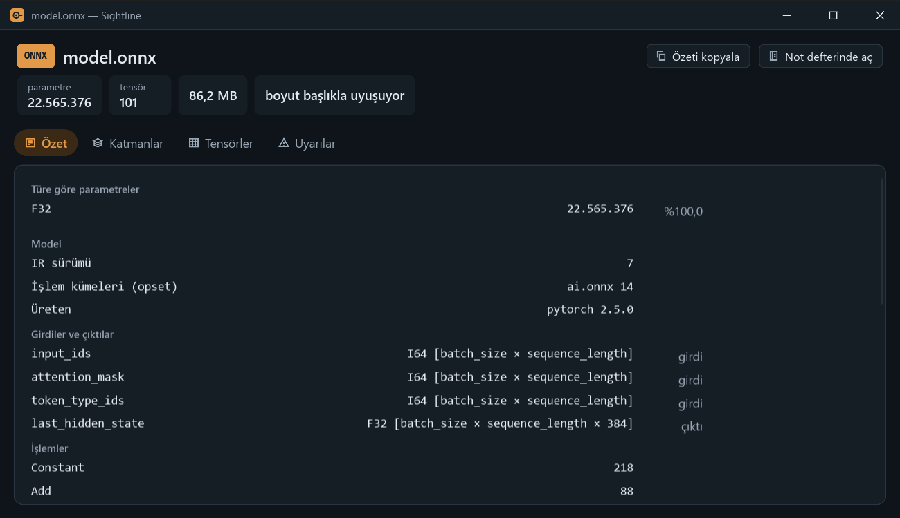
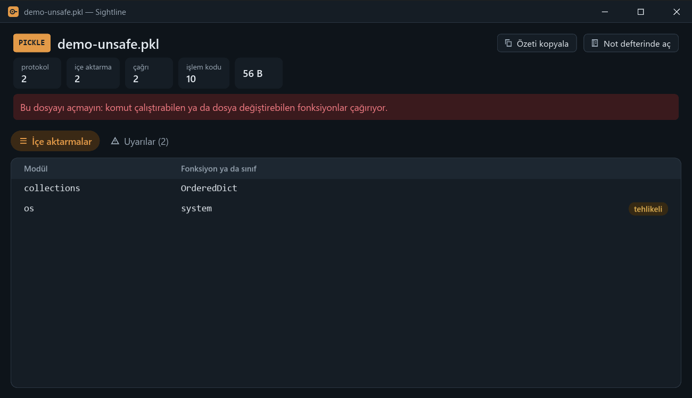
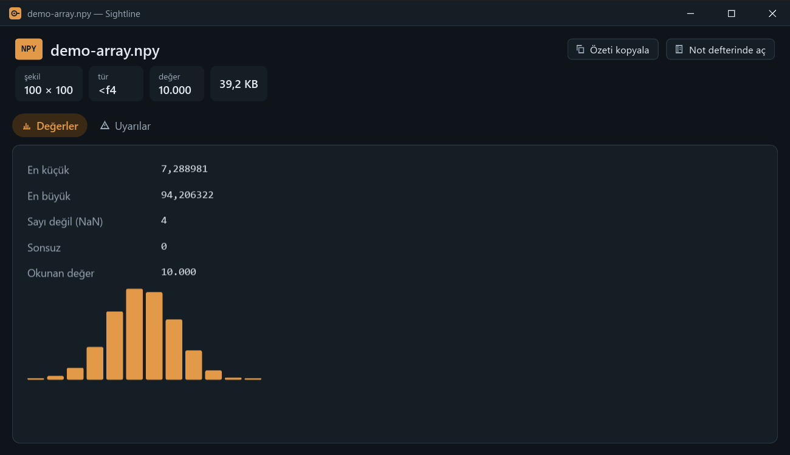

# Sightline

Veri dosyalarının içini açmadan gör.

Sightline, veri bilimciler ve ML mühendisleri için küçük bir Windows uygulaması. Gezgin'de bir CSV, Parquet, Excel, NPY, safetensors, ONNX ya da pickle dosyası seçip Space'e bastığında içinde ne olduğu bir pencerede görünür: tablonun şeması, satır sayısı, boş değerleri ve dağılımları; modelin katmanları, tensör şekilleri ve parametre sayısı; dizinin şekli ve değer aralığı; pickle'ı açsaydın hangi fonksiyonları çağıracağı. Python gerekmez, not defteri açmak gerekmez, 1 GB'lık dosyanın yüklenmesini beklemek gerekmez.

[English](README.md)



## Neleri okur

| Dosya | Ne görürsün |
|---|---|
| CSV | Ayırıcı ve kodlama (UTF-8 ya da Windows-1254), sütun türleri, boş değerler, benzersiz değer sayısı, histogram ya da en sık değerler, en küçük ve en büyük değer, ilk satırlar; istatistikler (ortalama, standart sapma, çeyrekler), her kategori sütununun en sık 10 değeri, korelasyon haritası ve boş hücre haritası; uyarılar |
| Parquet | Aynısı; satır sayısı ve istatistikler dosyanın üst verisinden, örneklem bütün dosyaya yayılmış |
| Excel (`.xlsx`, `.xlsm`) | İlk sayfa için aynısı, bütün sayfaların adlarıyla; tarihler tarih olarak, formül sonuçları Excel'in kaydettiği gibi (formüller hiç hesaplanmaz, makrolar hiç okunmaz) |
| safetensors | Her tensörün türü ve şekli, türe göre toplam parametre, katman ağacı, üst veri ve dosyanın başlığın söylediği uzunlukta olup olmadığı |
| ONNX | IR ve işlem kümesi sürümleri, üreten araç, şekilleriyle girdiler ve çıktılar, işlem sayıları, başlatıcılar ve parametreler |
| NPY | Şekil, tür, bellek sırası, en küçük, en büyük, NaN ve sonsuz sayısı, histogram (büyük dizilerde örneklemden) |
| Pickle (`.pkl`, `.pickle`) | Protokol, içe aktardığı fonksiyon ve sınıflar, kaç çağrı yaptığı ve `os.system` gibi tehlikeli olanlar için uyarı |

Uyarılar eğitimden önce bakılması gereken şeyleri gösterir: çok boş değerli sütunlar, kimlik sütununa benzeyenler, tek değerli sütunlar, çok çarpık sayılar, tarih aralıkları, boş değer yerine yazılmış olabilecek sıfırlar, aykırı değerler, dengesiz sınıflar, baskın değer, yinelenen satırlar, metin olarak saklanmış sayılar, aynı değerin farklı yazımları ve birlikte değişen sütun çiftleri.

"Not defterinde aç", dosyayı okuyan kodla bir Jupyter not defterini `Belgeler\Sightline` altına yazar ve açar.



## Güvenlik ilkeleri

- **Dosyalar hiç değiştirilmez.** Sightline dosyaları yalnızca okumak için açar.
- **Hiçbir şey bilgisayarından çıkmaz.** Programda ağ kodu yok.
- **Pickle dosyaları asla yüklenmez.** Pickle açmak herhangi bir kodu çalıştırabilir. Sightline tek bir nesne kurmadan işlem kodlarını tek tek okur ve dosyanın neyi içe aktarıp çağıracağını listeler. Aynı nedenle `.npy` içindeki Python nesnesi dizileri okunmaz; pickle için üretilen not defteri de yalnızca `pickletools` ile işlem kodlarını listeler.
- **Büyük dosyalar ucuz kalır.** Okuyucular başlıklara ve örneklemlere bakar, ağırlık dosyalarının tamamını okumaz. ONNX ağırlıkları okunmadan atlanır, ayrı dosyalardaki ağırlıklar açılmaz.



## Ölçümler

| Ne | Sonuç |
|---|---|
| 1,08 GB'lık Parquet dosyasının özeti (32 milyon satır) | ortanca 102 ms, en çok 91 MB bellek |
| 1,2 GB'lık safetensors dosyasının özeti | ortanca 9,6 ms, en çok 5,3 MB bellek |
| 1,2 GB'lık NPY dosyasının özeti | ortanca 39,3 ms, en çok 21,2 MB bellek |
| Gezgin'de Space'ten önizleme penceresinin öne gelmesine | ortanca 11,1 ms |
| `sentence-transformers/all-MiniLM-L6-v2` parametreleri (safetensors) | 22.713.728, Hugging Face'in verdiği sayıyla aynı |

Süreler, disk önbelleğindeki dosyalarda release derlemesinin 10 çalıştırmasının ortancası.

## Kurulum

1. [Releases](https://github.com/AlicanKaya192/Sightline/releases) sayfasından `Sightline-1.0.0-windows-x64.zip` dosyasını indirip aç.
2. Açılan klasörde `sightline-app.exe --install` komutunu çalıştır.

Bu komut Sightline'ı `%LOCALAPPDATA%\Programs\Sightline` altına kopyalar; Başlat menüsüne bir kısayol, Gezgin'in sağ tık menüsüne "Sightline ile önizle" ve Ayarlar > Uygulamalar listesine bir kayıt ekler. Yönetici izni ve Python gerekmez. Program kod imzalı değil, bu yüzden Windows ilk açılışta uyarı gösterebilir.

Kaldırmak için Ayarlar > Uygulamalar'dan Sightline'ı kaldır ya da `sightline-app.exe --uninstall` çalıştır. Veri dosyalarına hiç dokunulmaz.

İstersen kurmadan, `sightline-app.exe`'yi herhangi bir klasörden de çalıştırabilirsin.

## Kullanım

- Dosyayı pencereye **sürükleyip bırak** ya da Gezgin'de **sağ tıklayıp** "Sightline ile önizle"yi seç.
- **Gezgin'de Space:** Sightline'ı `sightline-app.exe --tray` ile başlat. Bildirim alanında bekler; Gezgin'de desteklenen bir dosya seçip Space'e bas. Tepsi menüsünden Windows açılışında başlaması açılabilir (varsayılan kapalı).
- **Özeti kopyala**, özeti pencerenin dilinde düz metin olarak panoya koyar. **Esc** pencereyi kapatır.
- **Ayarlar:** dil (Windows'un dili, Türkçe ya da İngilizce), tema (sistem, açık ya da koyu), özetlerin örneklediği satır sayısı (10.000, 100.000 ya da 1.000.000; daha çok satır daha yavaştır ve daha çok bellek kullanır) ve Windows açılışında başlatma. Sightline seçimleri hatırlar; `--lang tr` ya da `--lang en` dili bir açılış için geçersiz kılar.
- **Komut satırı:** `sightline.exe ozet <dosya>` aynı özeti metin olarak yazdırır.



## Kaynaktan derleme

Sightline, Rust ve [Slint](https://slint.dev) arayüz kütüphanesiyle yazıldı. Rust (MSVC araç zinciri) kuruluysa:

```
cargo build --release
cargo test --workspace
```

| Crate | Görevi |
|---|---|
| `crates/sightline-core` | Dosya okuyucuları ve özetler; arayüzden bağımsız |
| `crates/sightline-app` | Pencere, Gezgin entegrasyonu, tepsi, kurulum |
| `crates/sightline-cli` | `sightline ozet <dosya>` |

## Sınırlar

- PyTorch `.pt` ve `.pth`, `.npz`, parçalı safetensors, GGUF, eski `.xls` ve `.ods` dosyaları henüz desteklenmiyor.
- Excel çalışma kitabının yalnızca ilk sayfası özetlenir; bir sayfa açılmış hâliyle 64 MB XML'e kadar okunur, daha uzun sayfalarda satır sayısı "en az" diye verilir.
- ONNX parametre sayısı yalnızca başlatıcıları sayar. ONNX'e aktarılan bir model safetensors sürümünden farklı sayı verebilir: all-MiniLM-L6-v2'de dışa aktarım kullanılmayan pooler katmanını ve `position_ids` tamponunu (148.352 değer) içermiyor.
- Gezgin önizleme bölmesi (Alt+P) ve iki dosyanın şemasını karşılaştırma sonraki sürüm için planlandı.
- `.exe` dosyasının kendisi Gezgin'de Windows'un varsayılan simgesiyle görünür; pencere, tepsi, Başlat menüsü ve Ayarlar Sightline'ın simgesini kullanır.

## Lisans

Sightline'ın kendi kaynak kodu MIT Lisansı altındadır, bkz. [LICENSE](LICENSE). Pencere, Slint arayüz kütüphanesini GNU Genel Kamu Lisansı v3 ile kullanır; bu yüzden dağıtılan `sightline-app.exe` GPL v3 altındadır, bkz. [LICENSE-GPL-3.0.txt](LICENSE-GPL-3.0.txt). Komut satırı aracı `sightline.exe` Slint kullanmaz ve yalnızca MIT Lisansı altındadır.
